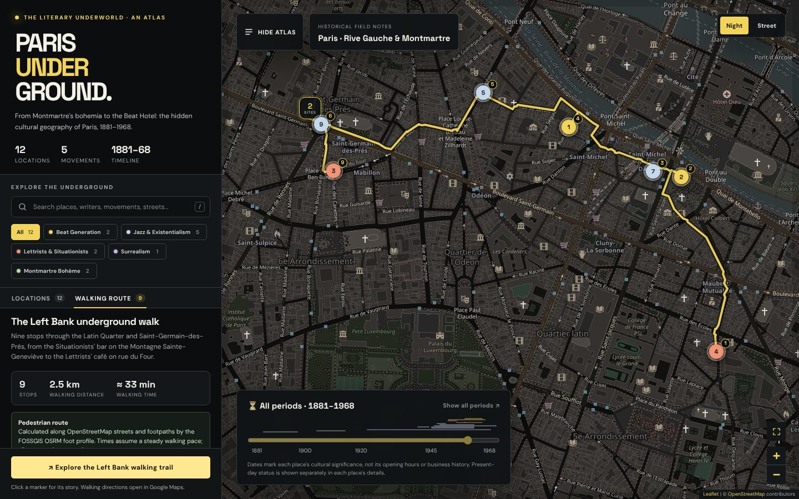

# PARIS UNDERGROUND — The Literary Underworld (1881–1968)

An interactive historical atlas of underground Paris: Montmartre cabarets, Surrealist studios, postwar jazz cellars, Lettrist cafés and the Beat Hotel. It is a small Python (FastAPI) server and a Leaflet map. The map uses no API keys, accounts or paid services.



## Quick start (macOS)

```bash
./start.command
```

You can also double-click `start.command` in Finder. On first run it creates a `.venv`, installs the dependencies and opens **http://127.0.0.1:8003** in your browser. Stop it with `Ctrl+C`.

It needs Python 3.11 or newer. If you don't have it, install it from [python.org](https://www.python.org/downloads/macos/) or with `brew install python@3.12`.

### Manual setup (any OS)

```bash
python3 -m venv .venv
source .venv/bin/activate
pip install -r requirements.txt
python run.py
```

`run.py` takes these options:

- `--no-browser`
- `--port 8010`
- `--reload` for development

If the atlas is already running on the port, `run.py` opens it instead of failing.

## Why the old prototype showed "API KEY REQUIRED"

The original HTML file was opened from disk and inspected in a real browser. Three separate faults stacked on top of each other:

| # | Fault | Evidence | Effect |
|---|---|---|---|
| 1 | The NIGHT basemap used CARTO's `basemaps.cartocdn.com/dark_all` tiles. | CARTO now answers **every** request with a 256×256 image reading "API KEY REQUIRED · carto.com/basemaps/apikey". The answer is HTTP **200**, whatever the Referer. | The visible error. Because the response is a 200, Leaflet never fires `tileerror`, and the prototype's fallback (which only checked whether Leaflet loaded) never triggered. |
| 2 | The `integrity` hash on `leaflet.css` was wrong: `…HNrzxjLvDxF4RLp33KJf7P3ANyA=` instead of `…HNrzRCf9tD/miZyoHS5obTRR9BMY=`. | Chrome logs "Failed to find a valid digest… The resource has been blocked". | Leaflet ran without its stylesheet. Tiles were scattered with gaps, markers were mispositioned or invisible, and controls were unstyled. |
| 3 | The STREET basemap used the deprecated `{s}.tile.openstreetmap.org` subdomains, requested from a `file://` page. | A `file://` page sends no `Referer`. OpenStreetMap's tile policy requires one, and a referer-less request was answered with an "Access blocked" tile. | Fragile at best, blocked at worst. |

### How the rebuild fixes it

- **Tiles.** Both styles use the standard OpenStreetMap raster tiles, `https://tile.openstreetmap.org/{z}/{x}/{y}.png`, with the required attribution. NIGHT is the same tiles with a CSS filter applied **only to Leaflet's tile pane**. Markers, tooltips, the route line and the controls are never filtered.
- **Served over HTTP.** Everything is served from `http://127.0.0.1:8003` with `Referrer-Policy: strict-origin-when-cross-origin`, and Leaflet's `referrerPolicy` option is set too. Tile requests therefore carry the page origin, as OSM requires.
- **No CDNs.** Leaflet, Leaflet.markercluster and both fonts (Space Grotesk, DM Sans) are vendored locally. The page makes no requests to unpkg or Google Fonts.
- **Strict Content-Security-Policy.** Images may only come from this server and the configured tile host, so a stray CARTO (or any other keyed) URL would be blocked outright.
- **Fewer tile requests.** Tiles are requested only where the map comes to rest (`updateWhenZooming: false`, `updateWhenIdle: true`), not for every zoom level a fly-to animation passes through.
- **Fallback.** The map tracks tile health: consecutive `tileerror`s, a 12-second no-tile timeout, and the browser's `offline` event. If the basemap is unavailable, a notice explains why and offers *Retry tiles*. The map shows a faint survey grid, and every marker, the list, search, filters, timeline, details and route keep working.
- **Proof.** The browser tests do more than check the configured URL. They inspect the actual tile **responses**: HTTP 200, `image/png`, the `Referer` sent, SHA-256 compared against the known CARTO and OSM placeholder tiles, the pixel colour count of each tile, and a screenshot of the rendered map.

## Features

- **Map.** Zoom and pan; numbered, colour-coded pins; clusters (rounded squares, so a cluster count never reads as a location number); hover tooltips; a highlighted selected pin; a fit-to-visible control. Selecting a place centres it without hiding it behind the detail panel.
- **NIGHT / STREET.** One OSM tile layer; NIGHT only adds the tile-pane filter. The choice is remembered per browser.
- **Movement filters.** All, Beat Generation, Jazz & Existentialism, Lettrists & Situationists, Surrealism, Montmartre Bohème. Each filter shows a live count, filters combine with search and the timeline, and *Clear filters* resets them all.
- **Search.** Matches names, people, movements, streets, tags and descriptions as you type. It ignores accents and ligatures, so `git le coeur` finds *Gît-le-Cœur*. Press `/` to focus the search box.
- **Timeline, 1881–1968.** Drag the slider to a year. A ribbon shows every place's period(s) of significance, and active places pulse on the map. *Show all periods* resets the year. The dates mark cultural significance, not business hours. Present-day status is shown separately.
- **Detail panel.** Shows the movement, period, documented history, associated figures, **Today** status (operating, closed, repurposed, rebuilt, private, unverified), the interpretation, evidence notes, location precision and every source. Actions: *View historical source*, *Open in Google Maps*, *Add to walking route*.
- **Walking itinerary.** The suggested 9-stop Left Bank walk, or a custom one (up to 11 stops; reorder, remove, clear). Real pedestrian routing comes from the key-free FOSSGIS OSRM foot profile: about **2.5 km and 33 min** for the suggested walk, with a distance for each leg. If routing is unavailable, the stops are joined by a dotted line labelled **"Illustrative route — not walking directions"**, and no distance is shown. *Walking directions in Google Maps* opens the same stops in Google Maps.
- **Responsive.** On desktop the sidebar is docked and collapsible. On tablets it narrows, and on narrow map areas the details open as a bottom sheet. On phones the sidebar becomes a drawer. Keyboard support: Tab to a pin and press Enter, Escape closes, and ARIA tabs, pressed states and live announcements are in place.
- **Deep links.** `http://127.0.0.1:8003/#place=beat-hotel` opens a place directly.

## Historical data

The data is plain JSON in `app/data/`. It is validated at startup with Pydantic models that reject unknown keys, bad coordinates and dangling references, so the server refuses to start on bad data.

| File | Contents |
|---|---|
| `locations.json` | The places (12 at present). |
| `movements.json` | Movement *groups*, which drive filters and colours, and the movements within them. |
| `itineraries.json` | Suggested walks. |
| `atlas.json` | Titles, the timeline range and the initial map view. |

### Separating fact from interpretation

Each location keeps these apart:

- **`description`** is the documented history, shown with a *Documented* badge.
- **`significance`** is editorial context, shown with an *Interpretation* badge.
- **`periods[].certainty`** is either `documented` or `approximate`. Periods may be open-ended (`"end": null`), and a place can have several.
- **`caveats`** records source disagreements and corrections.
- **`coordinates.precision`** and **`coordinates.note`** say how exactly the marker matches the site.
- **`status`** gives the present-day category and summary, kept apart from the historical period.

### Corrections made to the prototype

All 12 original locations and their stable IDs are kept. Each address was geocoded against OpenStreetMap (Nominatim). Seven prototype pins were within 25 m and are unchanged. Five were moved, and each corrected entry keeps its prototype coordinate in `coordinates.prototype`:

| Location | Prototype pin was off by |
|---|---|
| André Breton's studio, 42 rue Fontaine | 300 m (placed too far south) |
| Le Chat Noir, 12 rue Victor-Massé | 125 m |
| Club Saint-Germain, 13 rue Saint-Benoît | 101 m |
| Le Tonneau d'Or, 32 rue de la Montagne-Sainte-Geneviève | 91 m |
| Chez Moineau, 22 rue du Four | 45 m |

These dates were also revised against sources and noted in each place's `caveats`:

- **Le Chat Noir** closed in **1897**, the year Rodolphe Salis died (Musée Carnavalet). The prototype said 1896.
- **Le Tabou** opened on 11 April 1947. No source supports the prototype's 1962 end date, so the period ends with its documented decline around 1950 and is marked approximate.
- **Club Saint-Germain** opened in 1948. Sources say 1947 or 1948; both are noted.
- **Caveau de la Huchette** is open-ended (1946 to the present), because it still operates.

Two prototype source links were replaced. The Shakespeare and Company FAQ page doesn't mention the Le Mistral history, so it now points to the shop's history page. The Caveau's own website serves an expired TLS certificate, so Wikipedia and Visit Paris Region are used instead. Every source URL is opened in Chromium by the test suite.

### Adding a location

Append an object to `app/data/locations.json`; no code changes are needed. Numbering follows array order.

```json
{
  "id": "example-id",
  "name": "Name of the place",
  "address": { "street": "1 rue Example", "postcode": "75006", "arrondissement": "6e" },
  "coordinates": { "lat": 48.85, "lng": 2.34, "precision": "address", "note": "How the pin was placed." },
  "movements": ["lost-generation"],
  "periods": [{ "start": 1921, "end": 1941, "label": "1921–1941", "certainty": "documented" }],
  "figures": [{ "name": "Someone", "role": "Writer" }],
  "description": "Documented history (at least 40 characters).",
  "significance": "Interpretation and context.",
  "caveats": [],
  "status": { "category": "closed", "summary": "What is there today." },
  "sources": [{ "title": "Title", "publisher": "Publisher", "url": "https://…", "kind": "museum" }],
  "tags": ["keywords", "for", "search"]
}
```

The `status` and `kind` fields take these values:

- **`status.category`:** `operating`, `closed`, `demolished`, `repurposed`, `rebuilt`, `private` or `unknown`.
- **`sources[].kind`:** `museum`, `institution`, `archive`, `encyclopedia`, `venue`, `press` or `book`.

`movements.json` already defines groups for future expansion, but adds no locations to them:

- nineteenth-century literary Paris (Baudelaire, Rimbaud, Verlaine)
- the Lost Generation
- Dada (within the Surrealism group)
- May 1968

A group appears as a filter only once a location uses it. If a period falls outside 1881–1968, the timeline widens automatically.

## API

| Endpoint | Description |
|---|---|
| `GET /` | The atlas page. |
| `GET /api/atlas` | Everything the front end needs, in one request. |
| `GET /api/locations` | All locations. |
| `GET /api/locations/{id}` | One location. |
| `GET /api/movements`, `GET /api/itineraries` | Taxonomy and walks. |
| `GET /api/walking-route?stops=a,b,c` | Pedestrian route through 2–11 location IDs. Returns 503 with `{"fallback": "straight-line"}` if routing is unavailable. |
| `GET /api/health` | Status. |
| `GET /api/docs` | Interactive API documentation. |

The routing proxy accepts **only location IDs from the atlas**, never arbitrary coordinates. It sends a descriptive User-Agent, keeps to FOSSGIS's one-request-per-second policy, and caches results.

## Configuration

Every setting is optional and is read from an environment variable:

| Variable | Default |
|---|---|
| `PU_TILE_URL` | `https://tile.openstreetmap.org/{z}/{x}/{y}.png` |
| `PU_TILE_ATTRIBUTION` | © OpenStreetMap contributors |
| `PU_TILE_MAX_ZOOM` | `19` |
| `PU_ROUTING_URL` | `https://routing.openstreetmap.de/routed-foot/route/v1/driving` (FOSSGIS foot profile) |
| `PU_ROUTING_ENABLED` | `1` (set to `0` to always use the illustrative line) |
| `PU_DATA_DIR` | `app/data` |

The Content-Security-Policy follows `PU_TILE_URL` automatically, including `{s}` subdomains.

## Tests

```bash
pip install -r requirements-dev.txt
python -m playwright install chromium   # once, for the browser tests
python -m pytest                        # all 74 tests
```

You can narrow or redirect a run:

```bash
python -m pytest -m "not e2e"                            # data, API and routing only; no browser or network
python -m pytest -m "not network"                        # everything that works offline
E2E_BROWSER_CHANNEL=chrome python -m pytest              # use your installed Google Chrome
E2E_BASE_URL=http://127.0.0.1:8003 python -m pytest      # test an already running server
```

| Suite | What it covers |
|---|---|
| `test_data.py` | All 12 locations and their movements; coordinates either preserved or recorded as corrected; periods inside the timeline; valid references; typos and bad coordinates rejected; adding a location is JSON-only. |
| `test_api.py` | The page is served over HTTP with only local assets; CSP and Referrer-Policy headers; no keyed basemap or credential strings in the front end; API payloads. |
| `test_routing.py` | Route parsing; upstream request format and User-Agent; caching; rate limiting; validation; every failure mode signals the illustrative fallback. |
| `test_e2e_browser.py` | Real Chromium against a live server: verified tile responses and visible cartography (see above); no CARTO or key-bearing requests; tile-failure fallback; all 12 pins at their coordinates; sidebar selection centres the map; keyboard and deep links; each filter; search, including combined with filters; the timeline at several years and combined with filters; the NIGHT filter on the tile pane only; NIGHT and STREET rendering differently; the routed walk with a distance, a Google Maps URL and clearing; the labelled routing outage; a custom route; external links opening in new tabs; every source URL opening; desktop collapse; the mobile drawer and bottom sheet; no console errors. |

Screenshots from the browser tests are written to `tests/artifacts/`.

## Project structure

```text
paris-underground/
├── app/
│   ├── main.py            FastAPI app: page, JSON API, security headers
│   ├── config.py          settings and env vars; CSP built from the tile URL
│   ├── models.py          Pydantic schema for the data files
│   ├── store.py           loads, validates and cross-checks the data
│   ├── routing.py         FOSSGIS OSRM foot-routing client (rate-limited, cached)
│   ├── data/              atlas.json, locations.json, movements.json, itineraries.json
│   ├── templates/index.html
│   └── static/
│       ├── css/           app.css (theme), fonts.css
│       ├── js/            ES modules: main, atlas, map, sidebar, detail, timeline, route, utils
│       ├── fonts/         Space Grotesk and DM Sans (woff2, OFL)
│       ├── vendor/        Leaflet 1.9.4, Leaflet.markercluster 1.5.3
│       └── assets/        favicon
├── tests/                 pytest + Playwright
├── run.py                 cross-platform launcher
├── start.command          macOS one-command launcher
├── requirements.txt       runtime dependencies
└── requirements-dev.txt   test dependencies
```

The front end is plain ES modules with no build step. The modules share one small store, so filters, search, timeline, selection and route always stay consistent.

## Credits and usage policies

- **Map data and tiles:** © [OpenStreetMap contributors](https://www.openstreetmap.org/copyright), under the ODbL. The standard tiles are run by volunteers under the [tile usage policy](https://operations.osmfoundation.org/policies/tiles/), which is fine for personal and light use like this atlas. For heavy or public deployments, point `PU_TILE_URL` at another provider.
- **Walking routes:** [FOSSGIS OSRM](https://routing.openstreetmap.de/about.html), at most one request per second, with attribution and a "fix the map" link shown in the route panel.
- **Libraries:** [Leaflet](https://leafletjs.com) (BSD-2-Clause) and [Leaflet.markercluster](https://github.com/Leaflet/Leaflet.markercluster) (MIT). Their licences are in `app/static/vendor/`.
- **Fonts:** Space Grotesk and DM Sans, under the SIL Open Font License. The licences are in `app/static/fonts/`.
